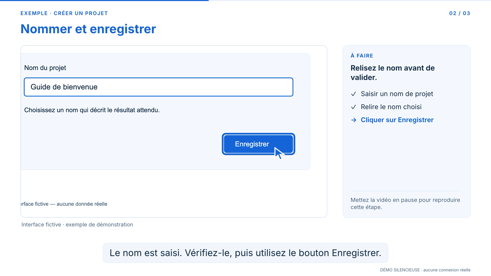

<div align="center">


# Autonomous SOP Video

### Your process, turned into a video anyone can follow.

Real screens. A clear voice. The exact button to click.<br>
Give your agent a workflow and get a chaptered tutorial for your team or your clients —<br>
with the screenshots, zooms, captions, and checklist already in place.

**[Watch the demo →](assets/demo.mp4)** · **[Install the skill](#install)** · **[Read the playbook](SKILL.md)**

[](assets/demo.mp4)

<sub>Codex + Claude Code · dedicated producer agent · ElevenLabs or your own voice · white label · editable source · MIT</sub>

<br><br>

<a href="https://bizos.cc"></a>

<br><br>

<a href="https://x.com/gauthierthiry"></a>
<a href="https://youtube.com/@gquthier"></a>

</div>

---

## Teach it once. Reuse it whenever someone needs help.

Onboarding a teammate, guiding a customer through setup, explaining permissions, documenting a recurring task: the useful part of a tutorial is knowing **where to click and what should happen next**.

This skill gives a coding agent a production workflow for making those tutorials. One producer owns the script, captures, narration, motion, and export. You review a pilot; the same visual language can then carry through a library.

- **Show the real interface.** Capture the current product, preserve the button labels, and zoom from the full screen into the exact control.
- **Keep people oriented.** A checklist on the right tracks the steps. Captions reinforce the narration. Chapters make it easy to return to a specific action.
- **Make it yours.** White background, blue titles, restrained motion, and no agency logo by default. Use it for internal training or client-facing resources.
- **Keep the source.** Change a screenshot or instruction when the software changes, then render again.

The public **24-second French example is silent and uses clearly labeled synthetic UI**. It demonstrates the included template, not an actual software workflow. A real SOP uses verified captures and the narration you choose.

## What you get

| Deliverable | Purpose |
| --- | --- |
| MP4 video | Share a finished, playable tutorial |
| SRT and VTT | Reuse captions in video players and editors |
| Embedded MP4 chapters + TXT/VTT | Jump to a step; retain sidecars for players with different chapter support |
| Editable composition | Update the screen, wording, voice, or timing |
| Evidence and QA notes | Know which screens, model, voice, and final frames were actually checked |

## Install

**Codex** — personal skill:

```bash
git clone https://github.com/gquthier/autonomous-sop-video.git \
  ~/.codex/skills/sop-video
```

**Claude Code** — personal skill:

```bash
git clone https://github.com/gquthier/autonomous-sop-video.git \
  ~/.claude/skills/sop-video
```

Use a new agent session if your runtime has already loaded its skill list. For a project-scoped installation, use `.codex/skills/sop-video` or `.claude/skills/sop-video` in that project.

Then ask:

> Use $sop-video to create a French SOP showing how to connect our CRM. Use the screenshots in this folder, a white background, blue titles, a checklist on the right, captions, and chapters. Keep my recorded voice. Make one pilot first.

Or:

> Crée une SOP en français pour montrer à un client comment partager l’accès à son compte publicitaire. Utilise les écrans actuels, une voix française ElevenLabs stable, et montre précisément les boutons. Fais une seule vidéo pilote pour mon feedback.

The producer role is defined in [agents/producer.md](agents/producer.md). A runtime with delegation can assign it to a dedicated agent; a runtime without delegation can perform the same role directly. The skill does not silently install an autonomous background service.

## Quickstart

Try the runnable example without a voice API. You need **Python 3.10+, Node.js 22+, FFmpeg/ffprobe**, and a Chrome version supported by [HyperFrames](https://hyperframes.heygen.com). The first build downloads GSAP; `npx` fetches the pinned renderer. Renderer and provider services have their own terms and possible usage costs.

From the cloned skill directory:

```bash
python3 scripts/sop.py init /tmp/my-first-sop
cd /tmp/my-first-sop
node build.mjs
npm run check
npm run preview -- --background
npm run render -- --quality delivery --output renders/video.mp4 --workers 1
```

Use a new, empty destination; `init` will not overwrite an existing project. Add `--gpu` to the render command only when your environment supports it.

Export captions and chapters, then embed the chapters in the video:

```bash
# Set this to your installed skill directory.
SKILL_DIR="$HOME/.codex/skills/sop-video"

python3 "$SKILL_DIR/scripts/sop.py" validate sop.json --probe
python3 "$SKILL_DIR/scripts/sop.py" chapters sop.json --output delivery
python3 "$SKILL_DIR/scripts/sop.py" embed \
  renders/video.mp4 delivery/chapters.ffmetadata delivery/video.mp4
```

The helper copies the video streams without re-encoding. It refuses to overwrite an existing output.

## From a real workflow to a finished video

1. **Define the result.** Audience, task, prerequisites, language, voice, and what “done” looks like.
2. **Observe and capture.** Record real screens, dates, native image sizes, and button coordinates. Remove private data from the pixels before export.
3. **Write and voice.** Explain one action at a time. Generate or use the narration, measure the audio, and build scenes to fit it.
4. **Compose.** Keep the screenshot large, the checklist on the right, and the relevant control readable during each zoom.
5. **Verify.** Validate timing and assets, run the renderer checks, inspect each scene, and check the final encoded video.
6. **Deliver.** Export the MP4, captions, chapters, editable source, and a short QA report. Stop at one pilot when that is the requested scope.

## Voice and model choice

**Voice:** ElevenLabs, a supported native narration tool, or an authorized recording you provide. Keep the chosen voice, model, and settings consistent across a series. The included helper handles assets and timing; the agent uses your available provider tools for synthesis. API keys stay in your local environment and out of the repository.

**Motion:** a capable coding model writes the HTML/GSAP composition, which HyperFrames renders. The playbook prefers your requested model, checks that it actually exists in your runtime, tests a representative scene, and records the actual model and reported usage. Opus-family models are supported through an available runtime; there is no hardcoded “best model” claim or invented model alias. Read [model selection](references/models.md).

**Languages:** the agent follows your brief. The example and the original pilot are French. Captions and chapters use the same timeline as the final narration.

## Inside the repository

```text
SKILL.md                    Agent entry point
agents/producer.md          Dedicated producer brief
agents/openai.yaml          Codex discovery metadata
references/                 Capture, audio, models, production, manifest
scripts/sop.py              Initialize, validate, export captions/chapters, mux
assets/starter/             Runnable 3-step synthetic example
tests/                      Timing, asset, geometry, and export checks
assets/demo.mp4              Rendered public example with embedded chapters
assets/preview.png           Preview for this README
```

The starter uses a single paused, seekable GSAP timeline. Targets are specified in the screenshot’s native coordinates; the builder computes the camera movement. The validator checks image dimensions, target bounds, voice durations, caption overlap, and project-relative assets. See the [manifest reference](references/manifest.md).

## Verification and limits

The visual workflow was developed against a **5 min 06 French SOP** with real anonymized screenshots, stable narration, and 12 embedded chapters. Those private screenshots and the client tutorial are not included here.

This public repository contains its own reproducible synthetic example. Run the tests and renderer check after changing the template. Automated checks help catch timing and structure errors; **a human or agent still needs to inspect the exported frames**. A screenshot does not prove an action was executed. The instructions keep those states distinct.

## Contribute

Open an issue with the command, error, renderer version, and a redacted screenshot. For a template change, include a rendered frame and the checks you ran. Keep examples synthetic or explicitly cleared for public use.

MIT for this repository’s original code, instructions, and synthetic example. HyperFrames, GSAP, and any media or voice providers retain their own licenses and terms. Bring your own authorized captures and narration.

---

<div align="center">

### Building something that runs itself?

**[bizos.cc](https://bizos.cc)** — build autonomous companies.

<sub>Built by [Gauthier Thiry](https://x.com/gauthierthiry)</sub>

</div>
