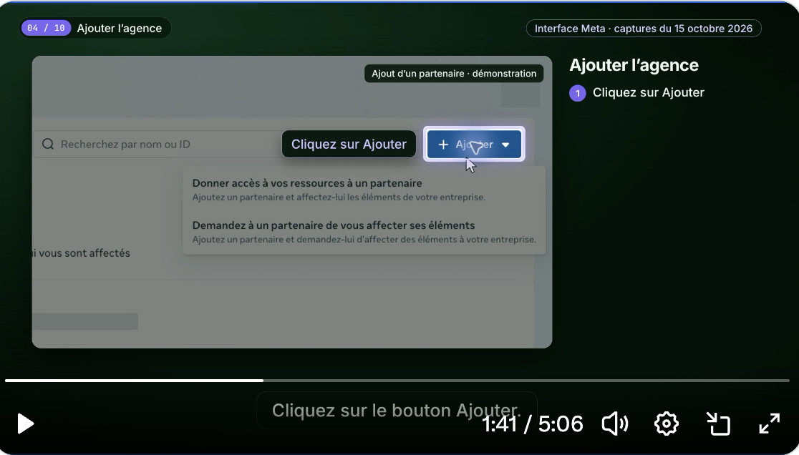

<div align="center">


# Autonomous SOP Video

### Your process, turned into a video anyone can follow.

Real screens. A clear voice. The exact button to click.<br>
Give your agent a workflow and get a chaptered tutorial for your team or your clients —<br>
with the screenshots, zooms, captions, and checklist already in place.

**[Install the skill](#install)** · **[Read the playbook](SKILL.md)**



<sub>Codex + Claude Code · dedicated producer agent · ElevenLabs or your own voice · white label · editable source · MIT</sub>

<br><br>

<a href="https://bizos.cc"></a>

<br><br>

<a href="https://x.com/gauthierthiry"></a>
<a href="https://youtube.com/@gquthier"></a>

</div>

---

## Teach it once. Reuse it whenever someone needs help.

Onboarding a teammate, guiding a customer through setup, explaining permissions, documenting a recurring task: the useful part of a tutorial is knowing **where to click and what should happen next**.

This skill gives a coding agent a production workflow for making those tutorials. One producer owns the script, captures, narration, motion, and export. You review a pilot; the same visual language can then carry through a library.

- **Show the real interface.** Capture the current product, preserve the button labels, and zoom from the full screen into the exact control.
- **Keep people oriented.** A checklist on the right tracks the steps. Captions reinforce the narration. Chapters make it easy to return to a specific action.
- **Make it yours.** White background, blue titles, restrained motion, and no agency logo by default. Use it for internal training or client-facing resources.
- **Keep the source.** Change a screenshot or instruction when the software changes, then render again.

The separate [24-second French template example](assets/demo.mp4) is silent and uses clearly labeled synthetic UI. It demonstrates the included template, not an actual software workflow. A real SOP uses verified captures and the narration you choose.

## What you get

| Deliverable | Purpose |
| --- | --- |
| MP4 video | Share a finished, playable tutorial |
| SRT and VTT | Reuse captions in video players and editors |
| Embedded MP4 chapters + TXT/VTT | Jump to a step; retain sidecars for players with different chapter support |
| Editable composition | Update the screen, wording, voice, or timing |
| Evidence and QA notes | Know which screens, model, voice, and final frames were actually checked |

## Install

**Codex** — personal skill:

```bash
git clone https://github.com/gquthier/autonomous-sop-video.git \
  ~/.codex/skills/sop-video
```

**Claude Code** — personal skill:

```bash
git clone https://github.com/gquthier/autonomous-sop-video.git \
  ~/.claude/skills/sop-video
```

Use a new agent session if your runtime has already loaded its skill list. For a project-scoped installation, use `.codex/skills/sop-video` or `.claude/skills/sop-video` in that project.

Then ask:

> Use $sop-video to create a French SOP showing how to connect our CRM. Use the screenshots in this folder, a white background, blue titles, a checklist on the right, captions, and chapters. Keep my recorded voice. Make one pilot first.

Or:

> Crée une SOP en français pour montrer à un client comment partager l’accès à son compte publicitaire. Utilise les écrans actuels, une voix française ElevenLabs stable, et montre précisément les boutons. Fais une seule vidéo pilote pour mon feedback.

The producer role is defined in [agents/producer.md](agents/producer.md). A runtime with delegation can assign it to a dedicated agent; a runtime without delegation can perform the same role directly.

## Quickstart

Try the runnable example without a voice API. You need **Python 3.10+, Node.js 22+, FFmpeg/ffprobe**, and a Chrome version supported by [HyperFrames](https://hyperframes.heygen.com). Install the locked local GSAP dependency explicitly before building. The pin, integrity check, and third-party terms are in the [third-party notices](assets/starter/THIRD_PARTY.md). `npx` may fetch the pinned renderer and its browser dependencies. For offline preparation, all required packages and browser binaries must already be cached; add `--offline` to `npm ci` to prohibit package downloads. Renderer, GSAP, and provider services can have their own usage costs.

From the cloned skill directory:

```bash
python3 scripts/sop.py init /tmp/my-first-sop
cd /tmp/my-first-sop
npm ci --ignore-scripts --no-audit --no-fund
node build.mjs
npm run check
npm run preview  # optional interactive preview; stop it when finished
npm run render -- --quality delivery --output renders/video.mp4 --workers 1
```

Add `--gpu` to the render command only when your environment supports it.

Export captions and chapters, then embed the chapters in the video:

```bash
# Set this to your installed skill directory.
# Example for the shared agents installation; use the path actually installed.
SKILL_DIR="$HOME/.agents/skills/sop-video"

python3 "$SKILL_DIR/scripts/sop.py" validate sop.json --probe
python3 "$SKILL_DIR/scripts/sop.py" chapters sop.json --output delivery
python3 "$SKILL_DIR/scripts/sop.py" embed \
  renders/video.mp4 delivery/chapters.ffmetadata delivery/video.mp4
```

## From a real workflow to a finished video

Follow the procedure in [SKILL.md](SKILL.md). The example prompts above are sample requests. The bundled example and the original pilot are French; captions and chapters use the narration timeline.

## Voice and model choice

Narration routes are in [capture and audio](references/capture-and-audio.md#narration-modes). Model selection is in [model selection](references/models.md).

## Inside the repository

```text
SKILL.md                    Agent entry point
agents/producer.md          Dedicated producer brief
agents/openai.yaml          Codex discovery metadata
references/                 Capture, audio, models, production, manifest
scripts/sop.py              Initialize, validate, export captions/chapters, mux
assets/starter/             Runnable 3-step synthetic example
tests/                      Timing, asset, geometry, and export checks
assets/demo.mp4              Rendered public example with embedded chapters
assets/preview.png           Preview for this README
```

See the [manifest reference](references/manifest.md) and the [production reference](references/production.md).

## Verification and limits

The visual workflow was developed against a **5 min 06 French SOP** with real anonymized screenshots, stable narration, and 12 embedded chapters. The header image is an approved anonymized still from the first pilot. The full client tutorial and raw captures are not included here.

This public repository contains a synthetic example. Run the tests and renderer check after changing the template. The bundled [validation record](tests/VALIDATION.json) records the current pressure test: 23 Python and 32 Node tests, a newly rendered 24-second demo, chapter readback, and ten inspected decoded frames including all scene starts. The browser audit has zero errors and three documented structure warnings; motion assertions were disabled. That record covers a synthetic silent composition. Each real delivery uses the [release gates](references/production.md#release-gates-fail-closed).

## Contribute

Open an issue with the command, error, renderer version, and a redacted screenshot. For a template change, include a rendered frame and the checks you ran. Keep examples synthetic or explicitly cleared for public use.

MIT for this repository’s original code, instructions, and synthetic example. HyperFrames, GSAP, and any media or voice providers retain their own licenses and terms. Bring your own authorized captures and narration.

---

<div align="center">

### Building something that runs itself?

**[bizos.cc](https://bizos.cc)** — build autonomous companies.

<sub>Built by [Gauthier Thiry](https://x.com/gauthierthiry)</sub>

</div>
